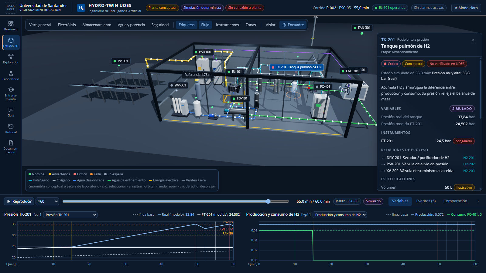
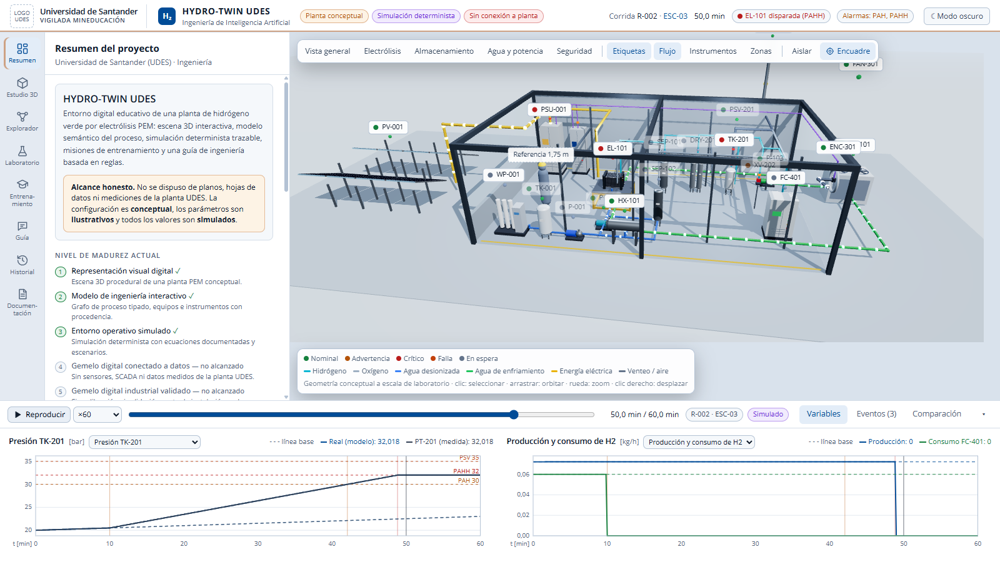
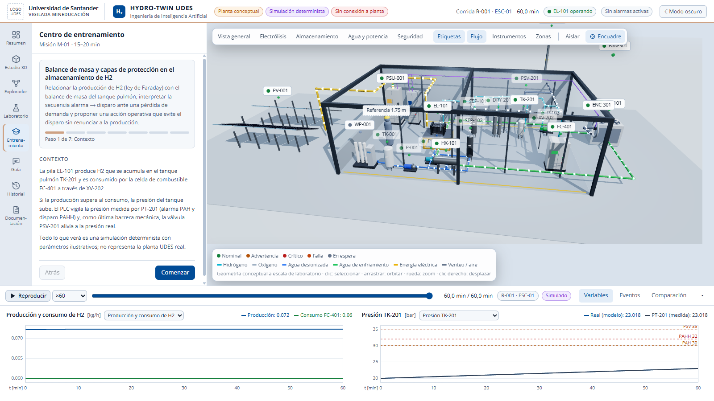

# HYDRO-TWIN UDES

**Gemelo digital educativo de una planta de hidrógeno verde**
Proyecto académico · **Universidad de Santander (UDES)** · Ingeniería de Inteligencia Artificial



## ¿Qué es?

HYDRO-TWIN UDES es una aplicación web que se ejecuta en el computador y representa una **planta de producción de hidrógeno verde por electrólisis PEM** a escala de laboratorio. Reúne en un mismo entorno:

- una **escena 3D interactiva** de la planta (geometría conceptual) en la que se puede orbitar, seleccionar equipos y ver su estado;
- un **modelo del proceso**: 21 equipos, 23 conexiones tipadas y 9 instrumentos, con validación automática de la topología;
- una **simulación determinista y trazable**: ley de Faraday, curva de polarización PEM, balance térmico, balance de masa del tanque, dilución de una fuga en el recinto, alarmas, disparos y válvula de alivio;
- **6 escenarios documentados**: operación normal, cambio de potencia, pérdida de demanda, falla de bomba, falla de sensor y fuga hipotética, con acciones de recuperación;
- una **misión de entrenamiento** (M-01) con rúbrica de 100 puntos calculada a partir de las corridas del propio estudiante;
- una **guía de ingeniería basada en reglas** (no es un modelo de lenguaje) que explica eventos y cambios citando la fuente de cada dato;
- **historial** de corridas y **comparación** contra una línea base.

## ¿Para qué sirve?

- **Docencia:** que los estudiantes entiendan cómo se conectan los equipos de una planta de hidrógeno verde, qué variables importan y cómo responden las protecciones ante una falla.
- **Entrenamiento:** practicar decisiones de operación en escenarios de falla sin riesgo y recibir retroalimentación explicada.
- **Investigación:** servir de base para un gemelo digital real de la planta de la UDES cuando existan planos y mediciones.

> **Alcance honesto.** No se dispuso de planos, hojas de datos ni mediciones de la planta de la UDES. La configuración de la planta es **conceptual**, los parámetros son **ilustrativos (no calibrados)** y todos los valores son **simulados**. La aplicación **no** está conectada a sensores ni controla equipos. El estado detallado está en [`docs/ESTADO_ACTUAL.md`](docs/ESTADO_ACTUAL.md).

## Capturas

| Modo claro | Misión de entrenamiento |
|---|---|
|  |  |

## Instalación

Requisitos: [Node.js](https://nodejs.org) 20 o superior (verificado con Node 24) y un navegador moderno (Edge o Chrome). No necesita base de datos, claves de API ni internet mientras se ejecuta.

### Clonar en VS Code

1. Abrir VS Code → botón **Clone Repository** (o `Ctrl+Shift+P` → «Git: Clone»).
2. Pegar `https://github.com/angelcrack2501-bit/udes-gemelo-digital-hidrogeno-verde` y elegir una carpeta (por ejemplo, Documentos).
3. Abrir la carpeta clonada cuando VS Code lo ofrezca.

O desde una terminal:

```bash
git clone https://github.com/angelcrack2501-bit/udes-gemelo-digital-hidrogeno-verde.git
```

### Ejecutar

En la terminal de VS Code (**Terminal → New Terminal**), dentro de la carpeta del proyecto:

```bash
npm install
```

```bash
npm run dev
```

Abrir la dirección que muestre la terminal (normalmente <http://localhost:3000>; si ese puerto está ocupado, Next.js usa el 3001). Para detenerla: `Ctrl + C` en la terminal.

Para una demostración más fluida, usar la versión de producción:

```bash
npm run build
```

```bash
npm start
```

Pantalla recomendada: 1366 × 768 o superior.

### Enlaces directos para la demostración

| Enlace | Qué abre |
|---|---|
| `/?seccion=studio&sel=EL-101` | Estudio 3D con la pila PEM seleccionada |
| `/?seccion=lab&escenario=demand_loss&t=45&sel=TK-201` | Pérdida de demanda (ESC-03) en el minuto 45 |
| `/?seccion=lab&escenario=sensor_stuck&t=55&sel=PSV-201` | Sensor PT-201 congelado y válvula de alivio abierta (ESC-05) |
| `/?seccion=training` | Misión de entrenamiento M-01 |
| Añadir `&tema=claro` o `&tema=oscuro` | Forzar el modo de color |

## Identidad visual

Sigue el Manual de Marca UDES: **Azul UDES `#014C97`** como color principal, **Dorado UDES `#CEA284`** para acentos y tipografía **Open Sans**. Tiene modo claro y oscuro, con contraste verificado automáticamente. El logo oficial no se recrea: se coloca en `public/brand/` (ver [`public/brand/README.md`](public/brand/README.md)). Detalles en [`docs/IDENTIDAD_VISUAL.md`](docs/IDENTIDAD_VISUAL.md).

## Verificación

```bash
npm run lint        # revisión de estilo (ESLint)
npm run typecheck   # TypeScript estricto
npm test            # 48 pruebas unitarias (Vitest): física, motor, escenarios, topología, misión, guía, contraste
npm run build       # compilación de producción
npm run e2e         # recorrido completo de la demostración en el navegador (Playwright, 8 pruebas)
```

`npm run e2e` compila y arranca la versión de producción en el puerto 3000 y recorre la demostración de punta a punta. La primera vez hay que ejecutar `npx playwright install chromium`. Sin posibilidad de descarga: `PW_CHANNEL=msedge npm run e2e`. Con el puerto 3000 ocupado: `E2E_PORT=3100 npm run e2e`. Informe HTML de fallos: `npx playwright show-report`.

## Documentación

| Documento | Contenido |
|---|---|
| [`docs/ESTADO_ACTUAL.md`](docs/ESTADO_ACTUAL.md) | **Qué está completo, qué está parcial, limitaciones y próximos pasos** |
| [`docs/GUION_DEMOSTRACION.md`](docs/GUION_DEMOSTRACION.md) | Guion de demostración paso a paso para el profesor (≈ 15 min) |
| [`docs/ARQUITECTURA.md`](docs/ARQUITECTURA.md) | Arquitectura, decisiones técnicas y mapa de módulos |
| [`docs/LIMITACIONES_Y_VALIDACION.md`](docs/LIMITACIONES_Y_VALIDACION.md) | Modelo, supuestos, pruebas, procedencia de datos y trabajo futuro |
| [`docs/MATRIZ_INVESTIGACION.md`](docs/MATRIZ_INVESTIGACION.md) | Matriz de investigación con referencias verificadas |
| [`docs/IDENTIDAD_VISUAL.md`](docs/IDENTIDAD_VISUAL.md) | Aplicación del Manual de Marca UDES y tabla de contraste |
| En la aplicación → **Documentación** | Ecuaciones, parámetros con su procedencia, escenarios, referencias y limitaciones |

## Estructura del código

```
src/
  domain/     modelo del proceso: tipos, parámetros (única fuente de verdad), planta, topología
  sim/        motor de simulación, electroquímica, reglas de alarma, escenarios, comparación
  training/   misión M-01 y rúbrica de evaluación
  guide/      guía de ingeniería basada en reglas
  state/      estado compartido de la sesión (selección, corridas, reproducción, misión)
  scene/      escena 3D (React Three Fiber): disposición conceptual y modelos procedurales
  theme/      tokens de color UDES, modo claro/oscuro y prueba de contraste
  components/ interfaz: paneles, inspector, gráficas, resultados y documentación
e2e/          pruebas del recorrido de demostración (Playwright)
```

Tecnologías: Next.js 16, React 19, TypeScript, Tailwind CSS 4, Three.js con React Three Fiber, Vitest y Playwright.

## Créditos

Proyecto académico desarrollado en la **Universidad de Santander (UDES)**, programa de **Ingeniería de Inteligencia Artificial**, por Angel Santiago Vargas, con asistencia de Claude Code (Anthropic). Uso educativo; no constituye un sistema de control ni de seguridad industrial.
